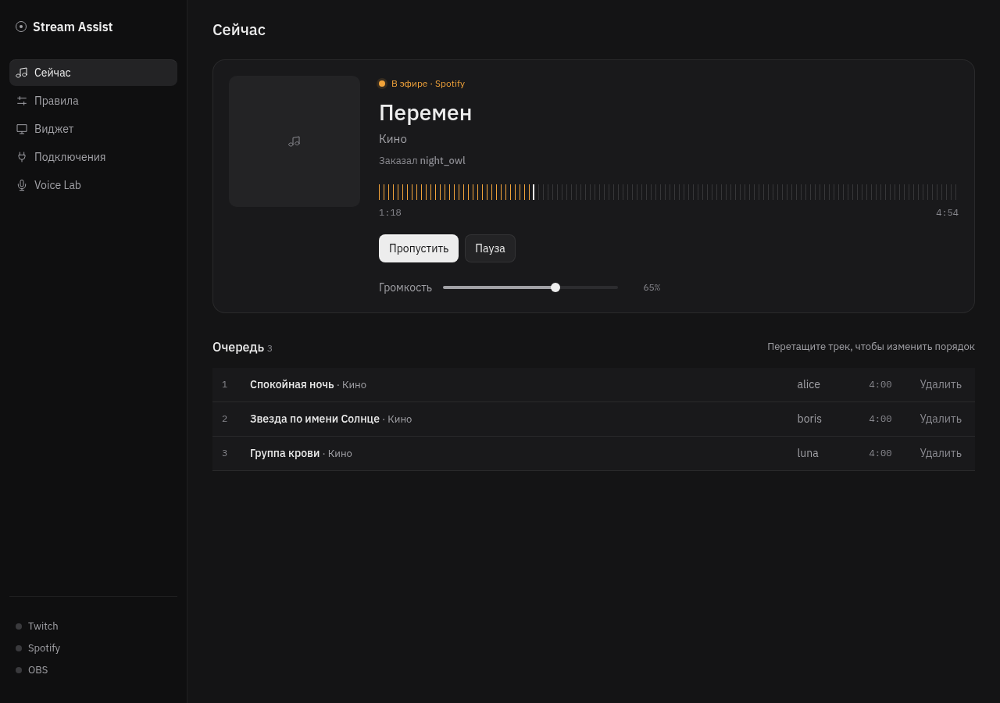
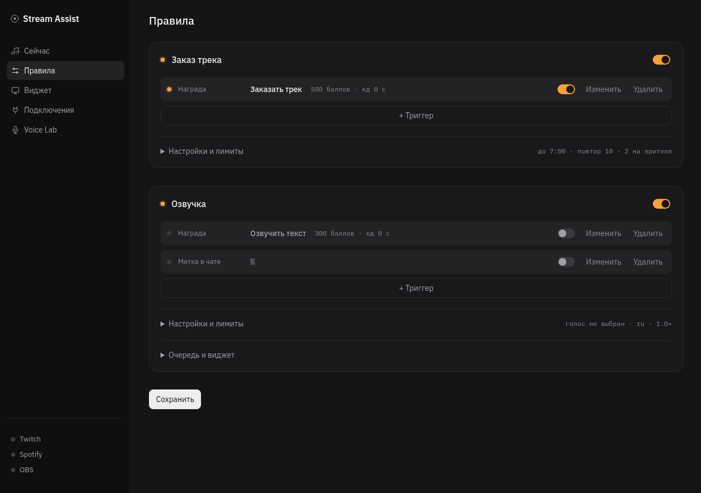
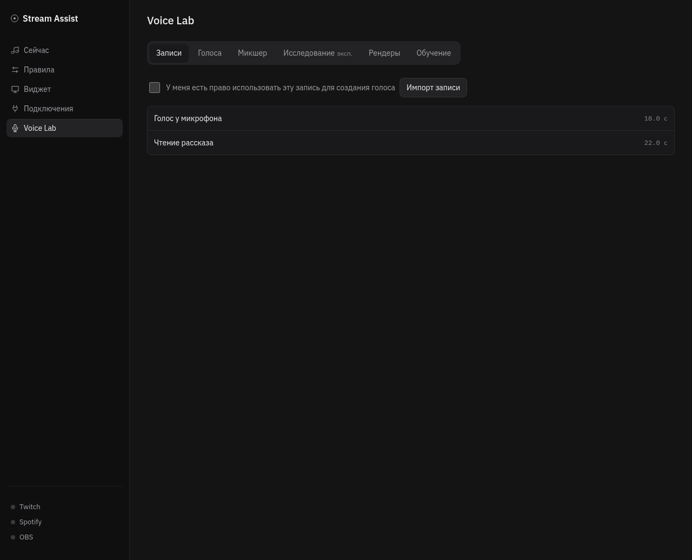

# Stream Assist

[](https://github.com/MushroomSquad/stream-assist/actions/workflows/ci.yml)
[](https://github.com/MushroomSquad/stream-assist/releases/latest)
[](LICENSE)

Настольный пульт стримера. Зрители тратят баллы канала Twitch, а Stream Assist
превращает их заказы в треки в вашем Spotify и в озвученные фразы в OBS.



## Возможности

- **Заказ музыки за баллы.** Зритель пишет название или ссылку Spotify/YouTube,
  трек встаёт в очередь и играет через Spotify стримера. YouTube — запасной источник.
- **Правила «триггер → действие».** Сами собираете, что запускает действие:
  награду за баллы или метку в чате (например `%` в конце сообщения).
  Лимиты, роли и кулдауны — у действия, награды их обходят.
- **Озвучка.** Текст награды и сообщения чата читаются голосом из Voice Lab
  отдельным аудиоисточником в OBS.
- **Виджет для OBS.** Текущий трек и очередь — встроенные темы или свои из zip.
- **Voice Lab.** Локальное клонирование и микширование голосов на Supertonic 3,
  дообучение на GPU (Linux + NVIDIA).
- **Честные баллы.** Если трек не сыграл или заказ отклонён — баллы возвращаются.



## Установка

Скачайте сборку для своей системы со [страницы релизов](https://github.com/MushroomSquad/stream-assist/releases/latest).

| Система | Файл |
|---|---|
| Windows 10/11 | `Stream.Assist_x.y.z_x64-setup.exe` или `.msi` |
| Debian / Ubuntu | `.deb` |
| Fedora / openSUSE | `.rpm` |
| Любой Linux | `.AppImage` |

- **Windows.** Сборки не подписаны, SmartScreen может показать предупреждение:
  «Подробнее» → «Выполнить в любом случае».
- **Linux.** Нужен glibc 2.39+ (Ubuntu 24.04, Debian 13, Fedora 40 и новее) —
  этого требует встроенный ONNX Runtime. И работающее хранилище ключей Secret Service (gnome-keyring или KWallet).

Дальше — [руководство стримера](docs/user-guide.md): подключение Twitch, Spotify и OBS
за пару минут.

## Требования

- Twitch-канал компаньона или партнёра (награды за баллы).
- Spotify Premium.
- OBS Studio 28+.

## Документация

- [Руководство стримера](docs/user-guide.md) — настройка, работа на стриме, правила, озвучка, частые проблемы.
- [Voice Lab](docs/voice-lab.md) — модель, клонирование, обучение, микшер, экспорт.
- [Темы виджета](docs/themes.md) — встроенные темы и как сделать свою.
- [Архитектура](docs/architecture.md) — устройство, инварианты, как добавить вид триггера или действие.
- [Изменения](CHANGELOG.md)



## Сборка из исходников

Нужны Node.js 22+, Rust stable и системные зависимости Tauri v2.
На Debian/Ubuntu:

```sh
sudo apt install libwebkit2gtk-4.1-dev libappindicator3-dev librsvg2-dev patchelf \
  libasound2-dev libdbus-1-dev pkg-config \
  libgstreamer1.0-dev libgstreamer-plugins-base1.0-dev \
  gstreamer1.0-plugins-base gstreamer1.0-plugins-good
```

На Fedora вместо `libasound2-dev` — `alsa-lib-devel`. Для первой сборки нужна сеть:
зависимость `ort` скачивает ONNX Runtime. CUDA и Python для базовых функций Voice Lab
не нужны; дообучение ставит отдельный пакет (около 8 ГиБ) через uv из вкладки «Обучение».

1. Зарегистрируйте приложение в [Twitch Developer Console](https://dev.twitch.tv/console/apps):
   Client Type **Public**, включён **Device Code Flow**, OAuth Redirect URL — любой
   (например `http://localhost`, программа его не использует).
2. Соберите, подставив Client ID — он встраивается в бинарник при компиляции:

   ```sh
   npm ci
   TWITCH_CLIENT_ID=… npm run tauri build
   ```

3. Пакеты появятся в `src-tauri/target/release/bundle/`.

Разработка и проверки:

```sh
TWITCH_CLIENT_ID=… npm run tauri dev
npm run check && node --test tests/*.mjs
(cd src-tauri && cargo test)
```

Без Tauri панель открывается в браузере на тестовых данных: `npm run dev` →
http://127.0.0.1:1420 (`?mock=errors` — с ошибками правил).

## Релиз

Версия задаётся в `package.json`, `src-tauri/Cargo.toml` и `src-tauri/tauri.conf.json`.
Тег `vX.Y.Z` запускает сборку Linux и Windows и создаёт черновик релиза
с пакетами. Client ID Twitch берётся из переменной репозитория `TWITCH_CLIENT_ID`.

## Лицензия

[MIT](LICENSE). Шрифты в `static/fonts` и темах виджета — SIL OFL 1.1 (лицензии рядом
с файлами), код тренера в `src-tauri/resources/trainer/upstream` — MIT.
